# 创建本地活动{#creating-a-local-campaign}

本地营销活动是从包含&#x200B;**特定执行计划**&#x200B;的&#x200B;**[!UICONTROL campaign packages]**&#x200B;列表中引用的模板创建的实例。 其目标是使用由中央实体设置和配置的活动模板满足本地通信需求。 实施本地操作的主要阶段如下：

中央实体&#x200B;**的**

1. 创建本地活动模板。
1. 从模板创建活动包。
1. 发布活动包。
1. 正在审批订单。

本地实体&#x200B;**的**

1. 订购营销活动。
1. 执行活动。

## 创建本地活动模板 {#creating-a-local-campaign-template}

要创建营销活动包，您必须首先通过&#x200B;**[!UICONTROL Resources > Templates]**&#x200B;节点创建&#x200B;**营销活动模板**。

要创建新的本地模板，请复制默认的&#x200B;**[!UICONTROL Local campaign (opLocal)]**&#x200B;模板。

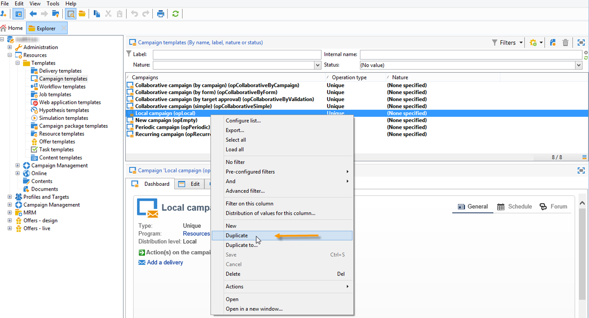

命名您的营销活动模板并填写可用字段。

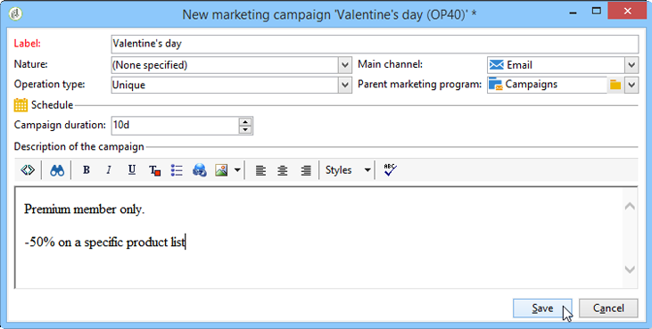

在营销活动窗口中，单击&#x200B;**[!UICONTROL Edit]**&#x200B;选项卡，然后单击&#x200B;**[!UICONTROL Advanced campaign parameters...]**&#x200B;链接。

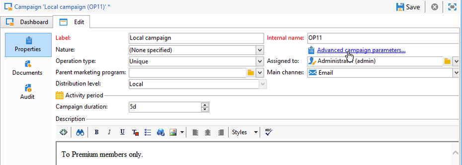

### Web 界面 {#web-interface}

在&#x200B;**分布式营销**&#x200B;选项卡中，您可以选择Web界面的类型，并指定本地实体下达订单时要输入的默认值和参数。

Web界面对应于本地实体在订购营销活动时要填充的表单。

Select要应用于从模板创建的营销活动的Web界面类型：

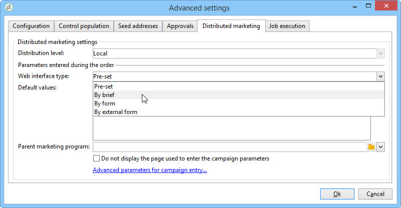

有四种类型的Web界面可用：

* **[!UICONTROL By brief]**：本地实体必须提供描述，以便描述营销活动配置。 订单获得批准后，中央实体会配置并执行整个营销活动。

  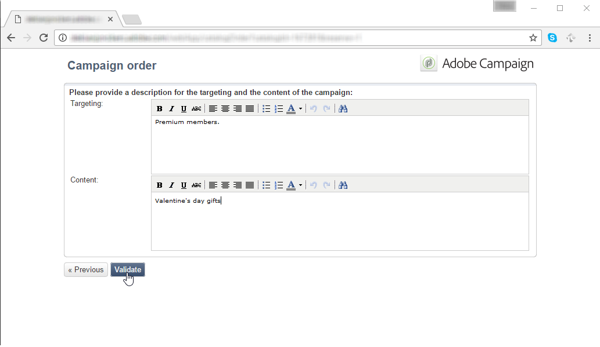

* **[!UICONTROL By form]**：本地实体有权访问Web窗体，本地实体可以在其中使用个性化字段编辑内容、目标、最大大小以及创建和提取日期，具体取决于使用的模板。 本地实体可以评估目标并预览此Web窗体中的内容。

  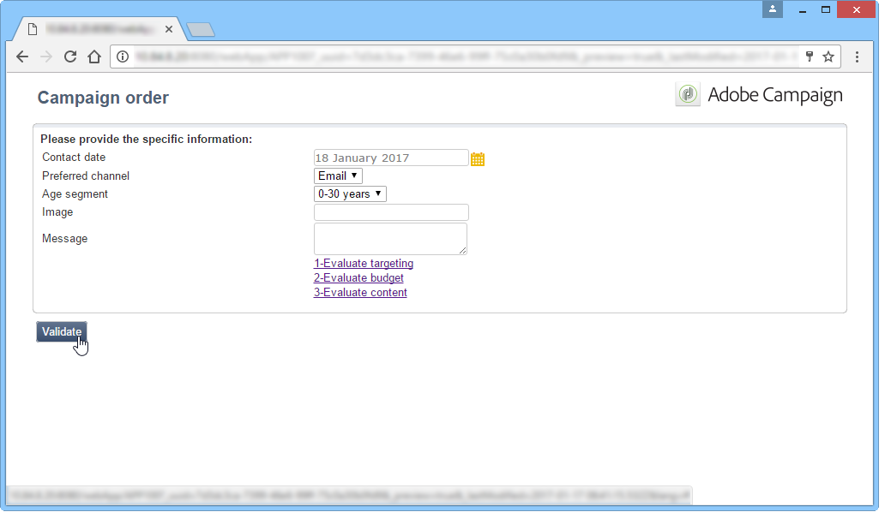

  提供的表单在Web应用程序中指定，必须从模板的&#x200B;**[!UICONTROL Advanced campaign parameters...]**&#x200B;链接的&#x200B;**[!UICONTROL web Interface]**&#x200B;字段的下拉列表中选择该应用程序。 请参阅[创建本地营销活动（按表单）](examples.md#creating-a-local-campaign--by-form-)。

  >[!NOTE]
  >
  >本示例中使用的Web应用程序就是一个示例。 您必须创建特定的Web应用程序才能使用表单。

  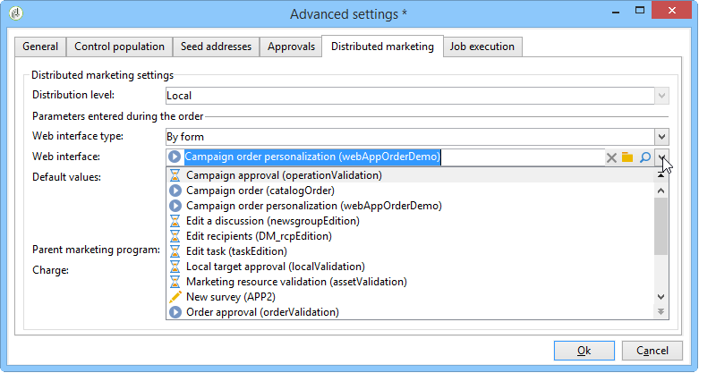

* **[!UICONTROL By external form]**：本地实体有权访问其外网（非Adobe Campaign）中的营销活动参数。 这些参数与&#x200B;**本地营销活动（按表单）**&#x200B;的参数相同。
* **[!UICONTROL Pre-set]**：本地实体订购使用默认表单的营销活动，而不进行本地化。

  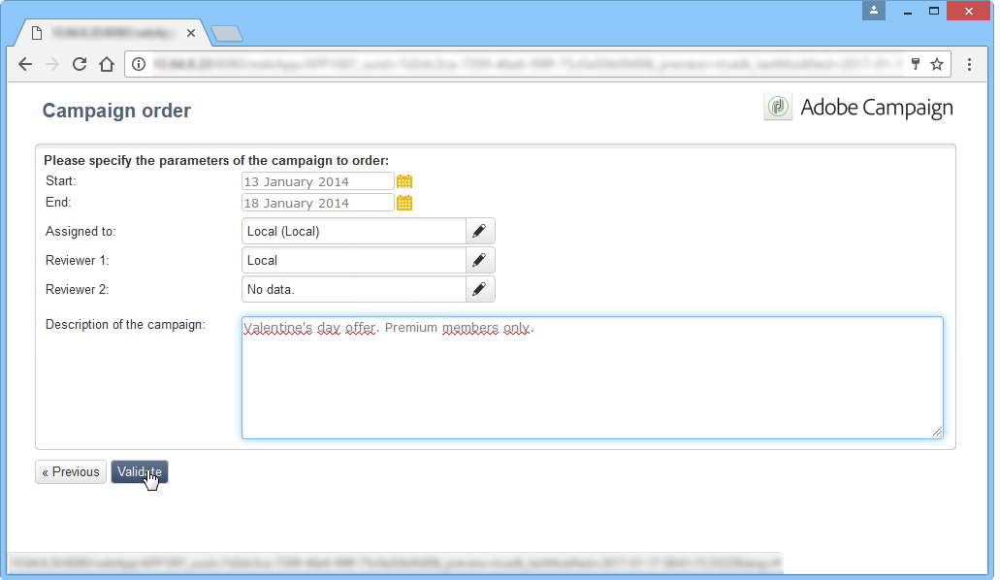

### 默认值 {#default-values}

Select本地实体要完成的&#x200B;**[!UICONTROL Default values]**。 例如：

* 联系和提取日期，
* 目标特征（年龄段等）。

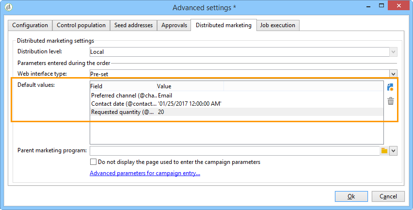

完成&#x200B;**[!UICONTROL Parent marketing program]**&#x200B;和&#x200B;**[!UICONTROL Charge]**&#x200B;字段。

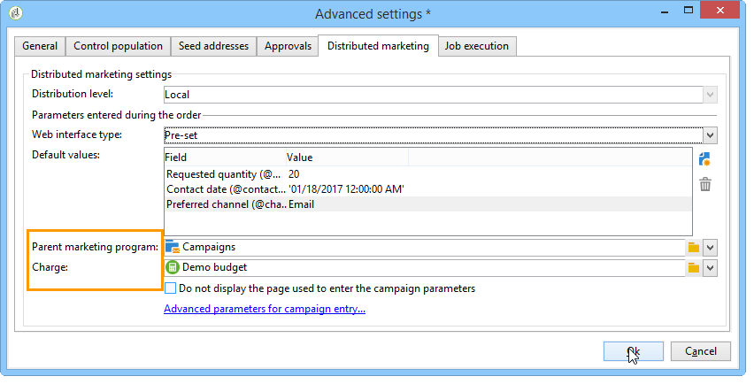

### 审批 {#approvals}

从&#x200B;**[!UICONTROL Advanced parameters for campaign entry]**&#x200B;链接中，可以指定最大审阅人数量。

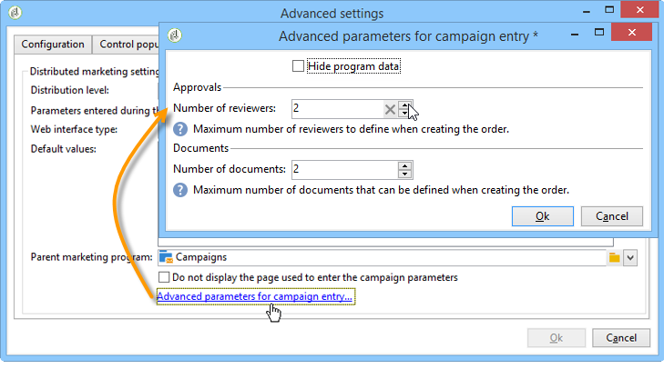

订购营销活动时，审阅人将由本地实体输入。

如果不希望为促销活动命名审阅者，请输入0。

### 文档 {#documents}

您可以允许本地实体运算符链接文档（文本文件、电子表格、图像、营销活动描述等） 到本地营销活动。 **[!UICONTROL Advanced parameters for campaign entry...]**&#x200B;链接允许您限制文档数量。 要实现此目的，只需在&#x200B;**[!UICONTROL Number of documents]**&#x200B;字段中输入允许的最大数量即可。

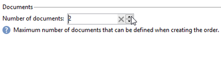

在订购营销活动包时，表单会建议关联模板中相应字段中所指示的任意数量的文档。

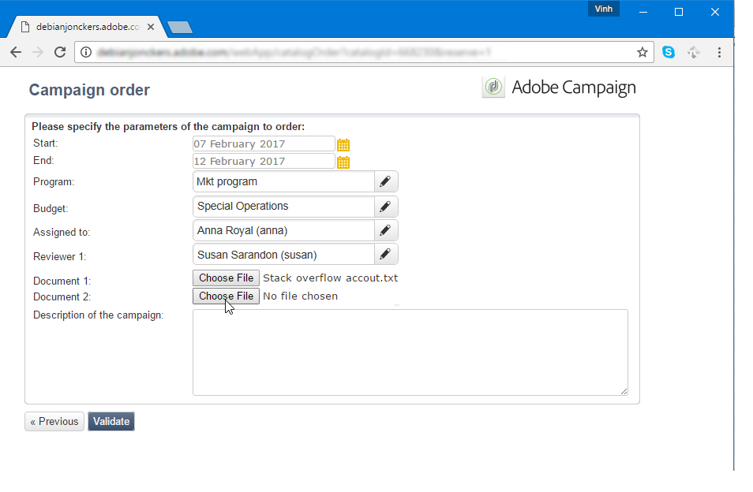

如果您不想显示文档上载字段，请在&#x200B;**[!UICONTROL Number of documents]**&#x200B;字段中输入&#x200B;**[!UICONTROL 0]**。

>[!NOTE]
>
>可以通过选中&#x200B;**[!UICONTROL Do not display the page used to enter the campaign parameters]**&#x200B;来停用&#x200B;**[!UICONTROL Advanced parameters for campaign entry]**。

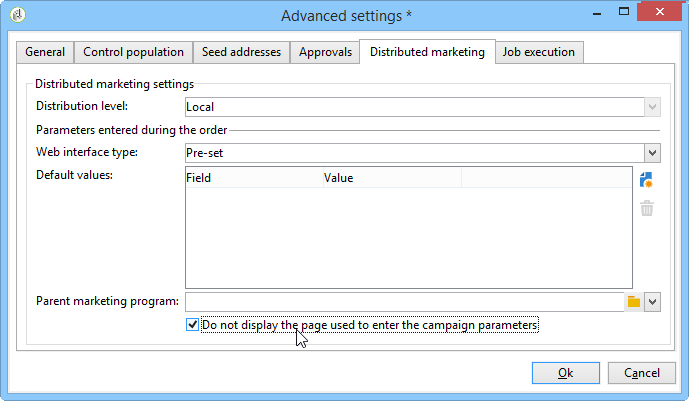

### 工作流 {#workflow}

在&#x200B;**[!UICONTROL Targeting and workflows]**&#x200B;选项卡中，创建收集&#x200B;**[!UICONTROL Advanced campaign parameters...]**&#x200B;中指定的&#x200B;**[!UICONTROL Default values]**&#x200B;并创建投放的营销活动工作流。

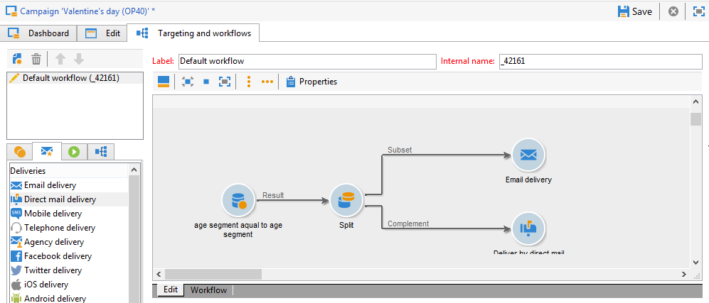

双击&#x200B;**[!UICONTROL Query]**&#x200B;活动以根据指定的&#x200B;**[!UICONTROL Default values]**&#x200B;对其进行配置。

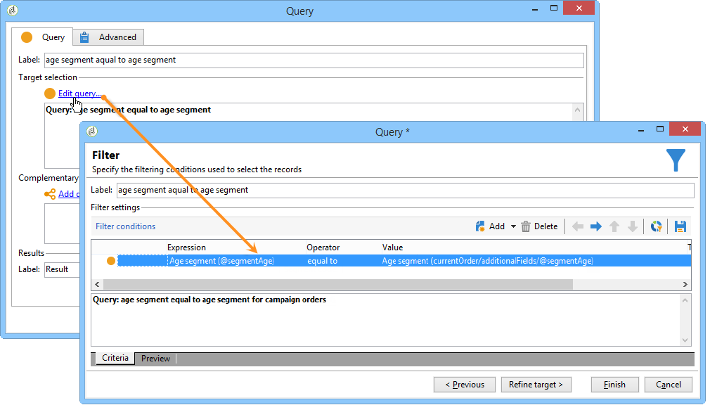

### 投放 {#delivery}

在&#x200B;**[!UICONTROL Audit]**&#x200B;选项卡中，单击&#x200B;**[!UICONTROL Detail...]**&#x200B;图标以查看所选投放的&#x200B;**[!UICONTROL Scheduling]**。

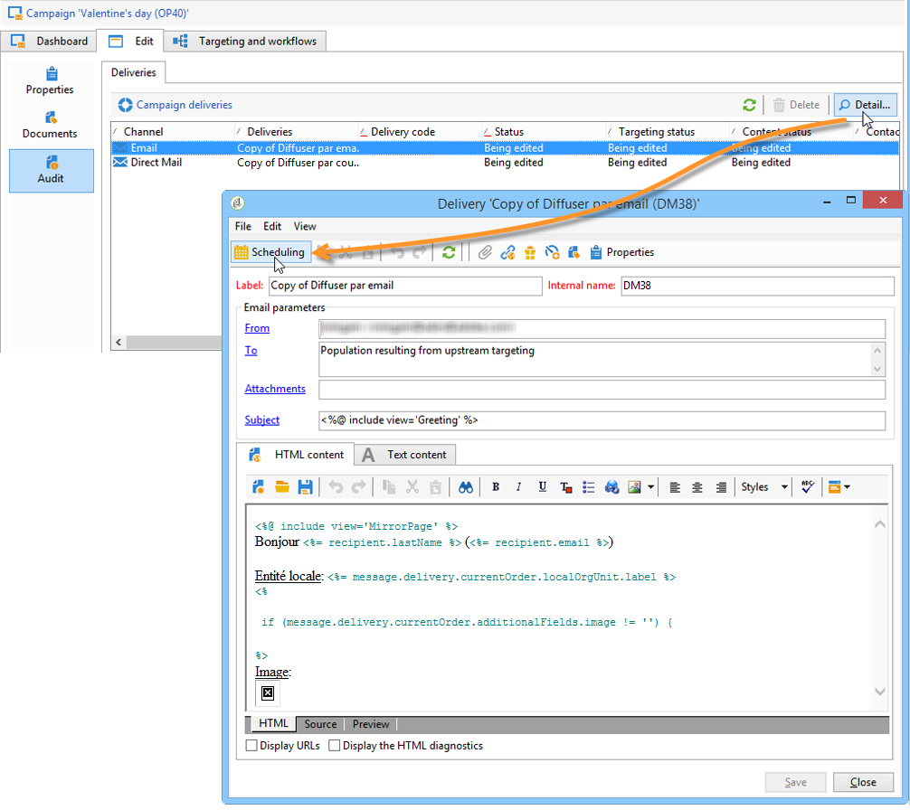

**[!UICONTROL Scheduling]**&#x200B;图标允许您配置投放的联系和执行日期。

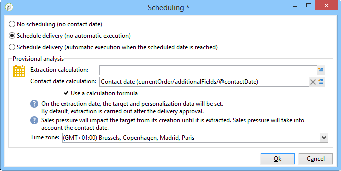

如有必要，请配置投放的最大大小：

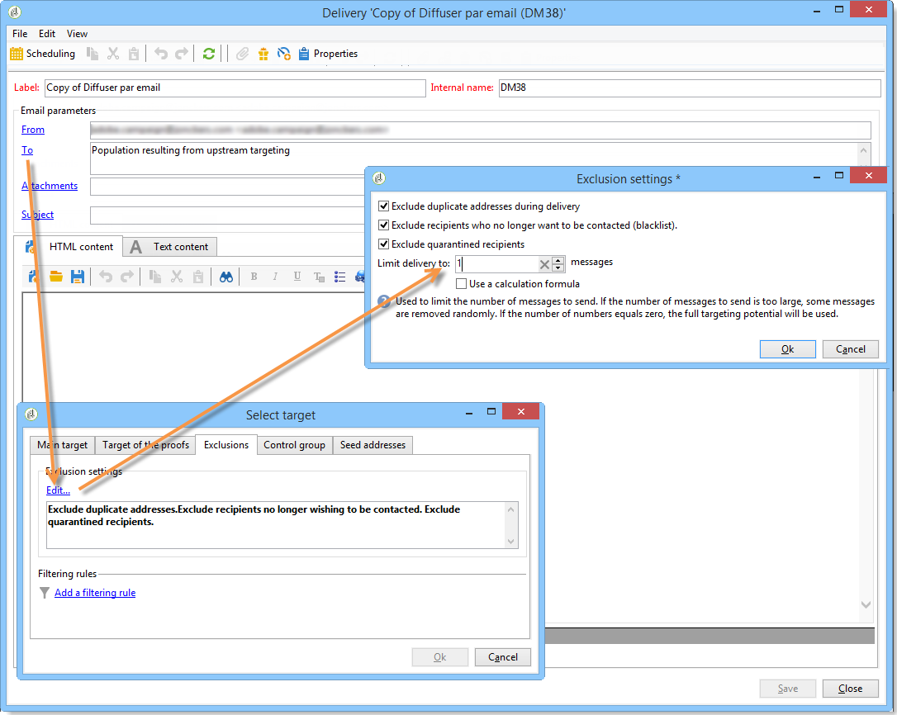

找到投放的HTML。 例如，在&#x200B;**[!UICONTROL Delivery > Current order > Additional fields]**&#x200B;中，使用&#x200B;**[!UICONTROL Age segment]**&#x200B;字段根据目标的年龄查找投放。

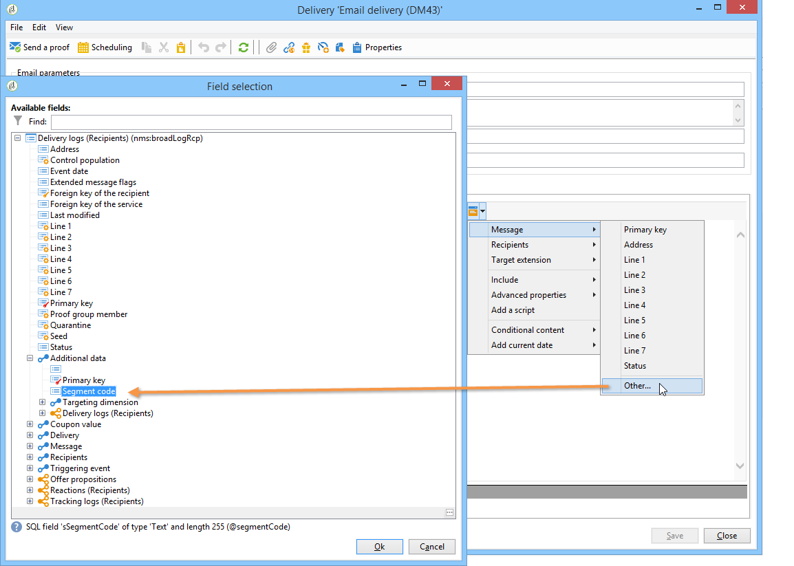插入的段代码附加数据字段

保存您的活动模板。 您现在可以从&#x200B;**[!UICONTROL Campaigns]**&#x200B;选项卡的&#x200B;**[!UICONTROL Campaign packages]**&#x200B;视图中，通过单击&#x200B;**[!UICONTROL Create]**&#x200B;按钮来使用它。

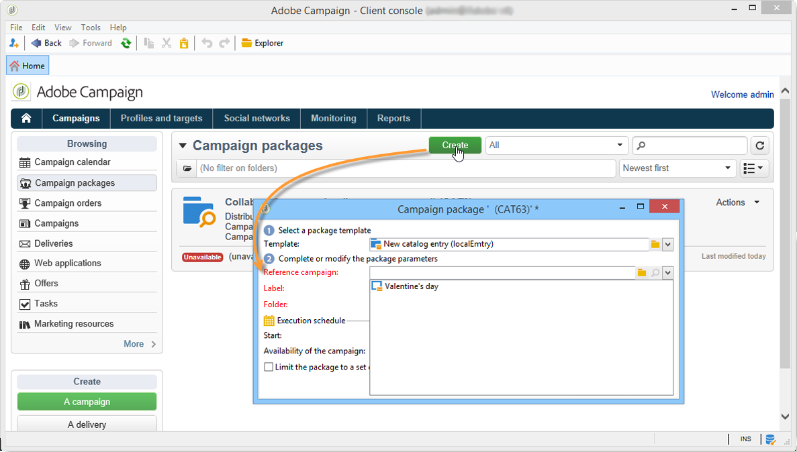

>[!NOTE]
>
>[营销活动模板](../campaigns/marketing-campaign-templates.md)中详细介绍了营销活动模板及其常规配置。

## 创建活动包 {#creating-the-campaign-package}

要使营销活动模板可供本地实体使用，需要将其添加到列表中。 为此，中央机构需要制定新的方案。

应用以下步骤：

1. 在&#x200B;**营销活动**&#x200B;页面的&#x200B;**[!UICONTROL Navigation]**&#x200B;部分中，单击&#x200B;**[!UICONTROL Campaign packages]**&#x200B;链接。
1. 单击 **[!UICONTROL Create]** 按钮。

   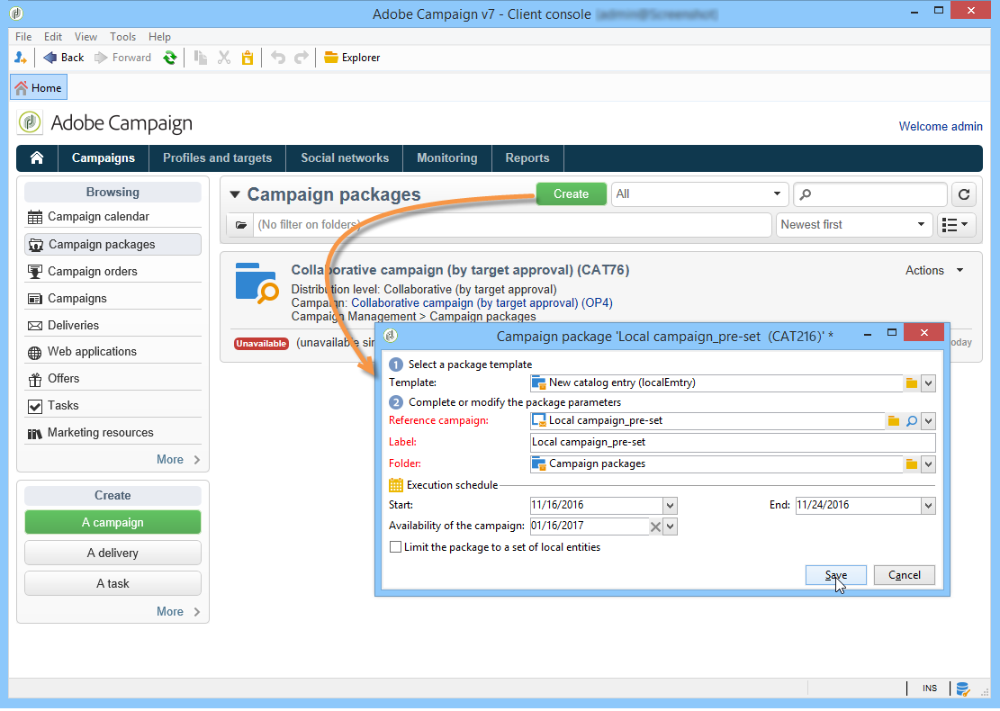

1. 窗口上方的部分允许您选择[以前](#creating-a-local-campaign-template)指定的营销活动包模板。

   默认情况下，**[!UICONTROL New local campaign package (localEmpty)]**&#x200B;模板用于本地营销活动。

1. 指定活动包的标签、文件夹和执行计划。

### 日期 {#dates}

开始日期和结束日期定义营销活动包列表中的营销活动可见性时段。

可用日期是促销活动对本地实体（要订购）可用的日期。

>[!CAUTION]
>
>如果本地实体未在截止日期前预留营销活动，则将无法使用该营销活动。

此信息可在发送给本地机构的通知消息中找到，如下所示：

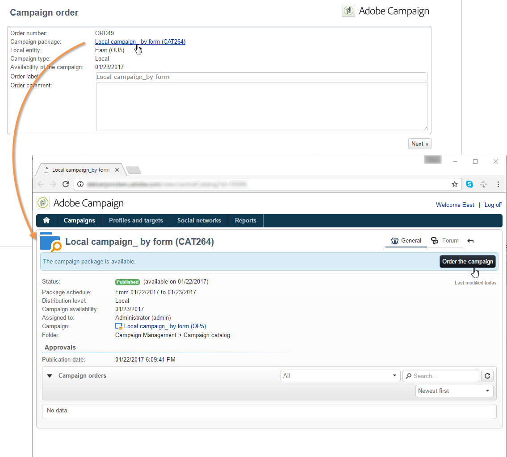

### 受众 {#audience}

对于本地营销活动，中央实体可以通过检查&#x200B;**[!UICONTROL Limit the package to a set of local entities]**&#x200B;来指定涉及的本地实体。

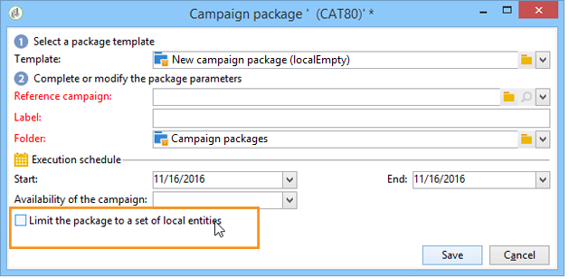

### 其他设置 {#additional-settings}

保存包后，中央实体可以从&#x200B;**[!UICONTROL Edit]**&#x200B;选项卡编辑它。

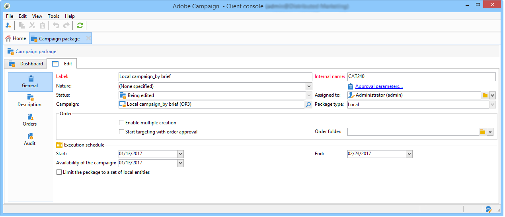

在&#x200B;**[!UICONTROL General]**&#x200B;选项卡中，中心实体可以：

* 通过&#x200B;**[!UICONTROL Approval parameters...]**&#x200B;链接配置营销活动包审阅者，
* 查看执行计划，
* 添加或删除本地实体。

>[!NOTE]
>
>默认情况下，每个实体只能对&#x200B;**本地营销活动**&#x200B;订购一次。
>   
>选中&#x200B;**[!UICONTROL Enable multiple creation]**&#x200B;选项以允许从营销活动包创建多个本地营销活动。

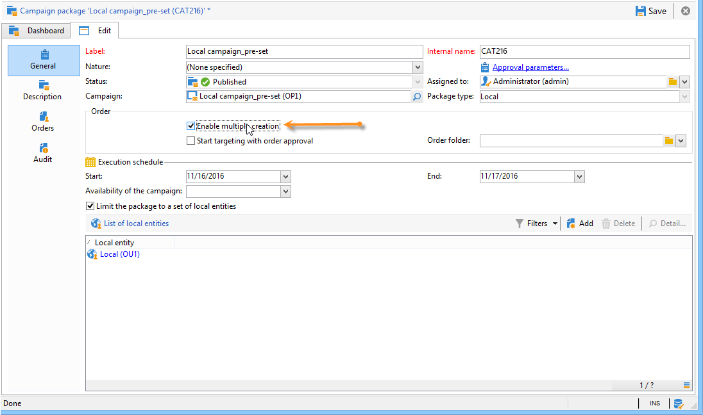

### 通知 {#notifications}

当营销活动可用或达到注册截止日期时，将向本地通知组的操作员发送消息。 有关详细信息，请参阅[组织实体](about-distributed-marketing.md#organizational-entities)。

## 订购营销活动 {#ordering-a-campaign}

活动包获得批准且实施期开始后，本地实体即可访问这些活动包。 本地实体会收到一封电子邮件，通知他们新的Campaign包可用（一旦达到可用日期）。

>[!NOTE]
>
>如果在创建活动包时指定了某些本地实体，则它们将是唯一接收通知的本地实体。 如果未指定本地实体，则所有本地实体都将收到通知。

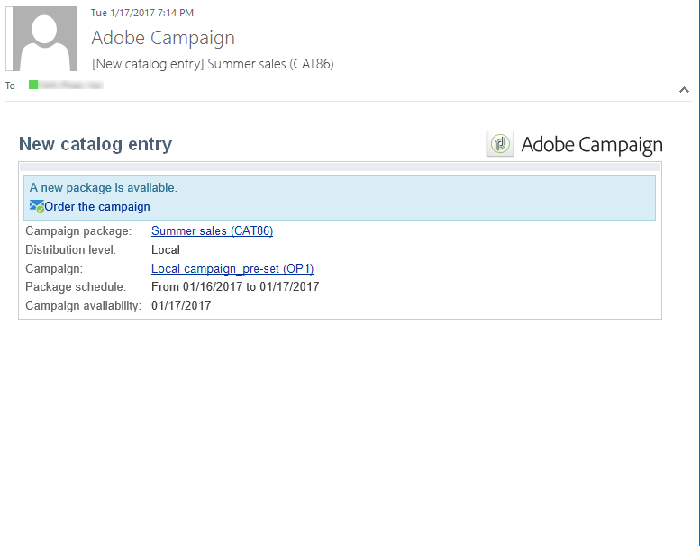

要使用中央实体提供的营销策划，本地实体必须对其进行排序。

要订购活动，请执行以下操作：

1. 单击通知消息中的&#x200B;**[!UICONTROL Order campaign]**，或单击Adobe Campaign中的相应按钮。

   输入您的ID和密码以订购营销活动。 该界面由Web应用程序中定义的一组页面组成。

1. 在首页中输入必需的信息（订单标签和备注），然后单击&#x200B;**[!UICONTROL Next]**。

   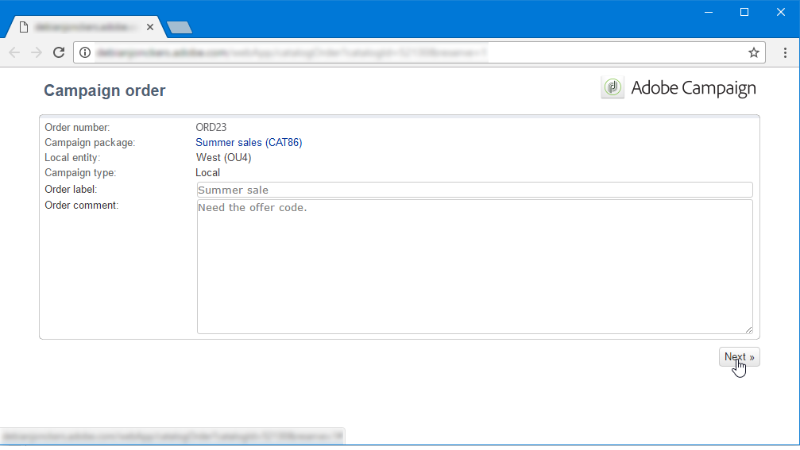

1. 完成可用参数并批准订单。

1. 系统会向本地实体所属组织实体的经理发送通知，以批准此订单。

   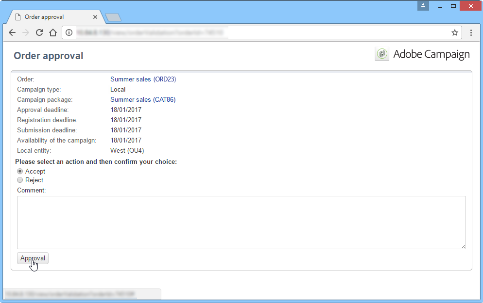

1. 信息被返回到本地和中央实体。 虽然本地实体只能查看自己的订单，但中央实体可以查看任何本地实体的所有订单，如下所示：

   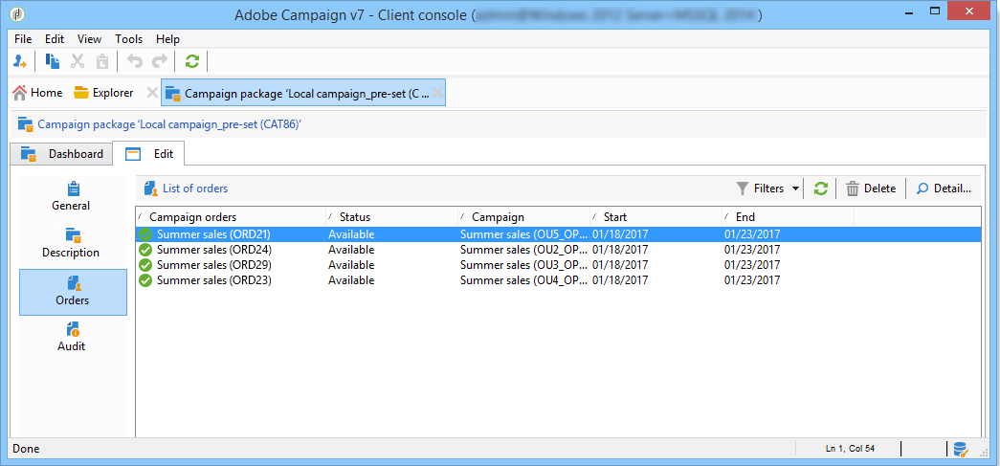

   操作员可以显示订单详细信息：

   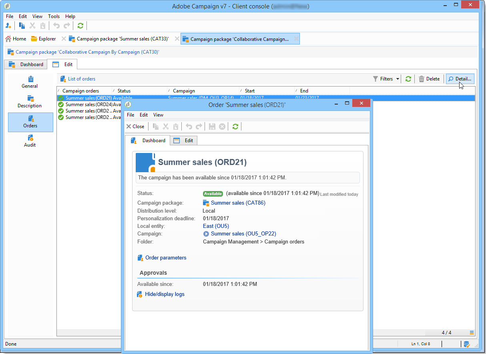

   **[!UICONTROL Edit]**&#x200B;选项卡包含本地实体在订购营销活动时输入的信息。

   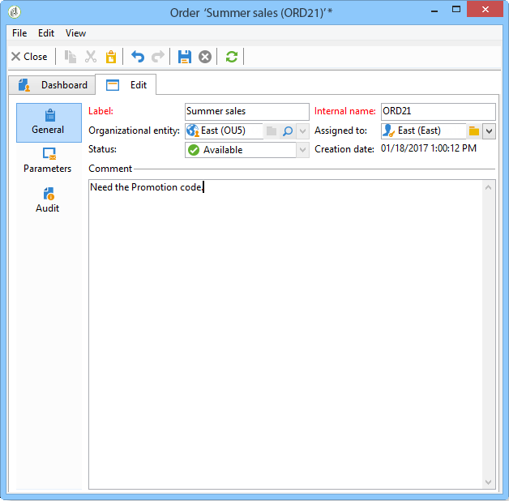

1. 该命令必须得到中央实体的批准才能最后确定。

   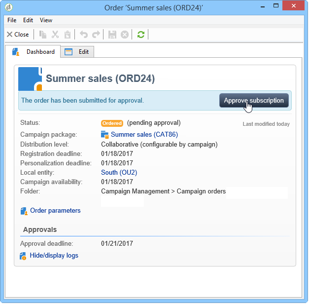

   有关更多信息，请参阅[审批流程](#approval-process)一节。

1. 然后，会通知本地操作员该营销活动可用：可以在&#x200B;**营销活动**&#x200B;选项卡中的营销活动包列表中找到营销活动可用性。 然后，可以使用营销策划。 有关详情，请参阅[访问营销活动](accessing-campaigns.md)。

   通过&#x200B;**[!UICONTROL Start targeting with order approval]**&#x200B;选项，本地实体可在订单获得批准后立即运行营销活动。

   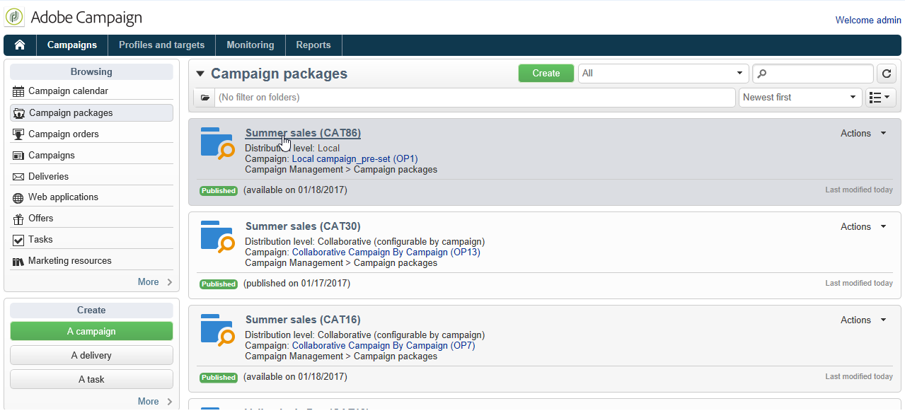

## 批准订单 {#approving-an-order}

要确认促销活动订单，必须获得中心实体的批准。

通过&#x200B;**促销活动**&#x200B;选项卡访问的&#x200B;**[!UICONTROL Campaign orders]**&#x200B;概述允许您查看并批准促销活动订单的状态。

>[!NOTE]
>
>本地实体可以对订单进行更改，直到获得批准为止。

### 审批流程 {#approval-process}

#### 电子邮件通知 {#email-notification}

当营销活动由本地实体订购时，其查看者会收到电子邮件通知，如下所示：

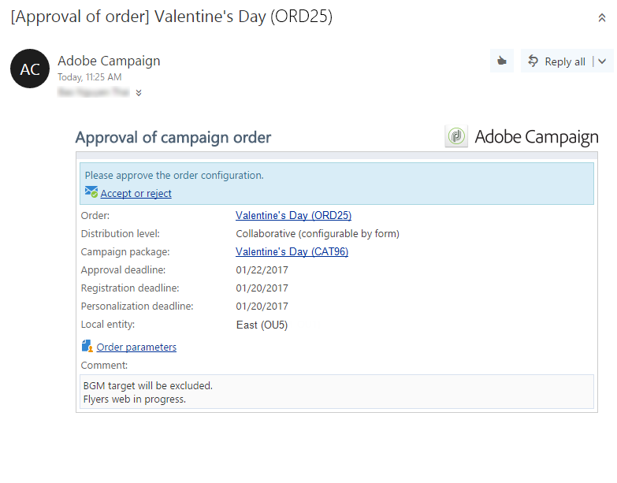

>[!NOTE]
>
>选择审阅人将显示在[审阅人](#reviewers)部分中。 他们可以接受或拒绝该订单。

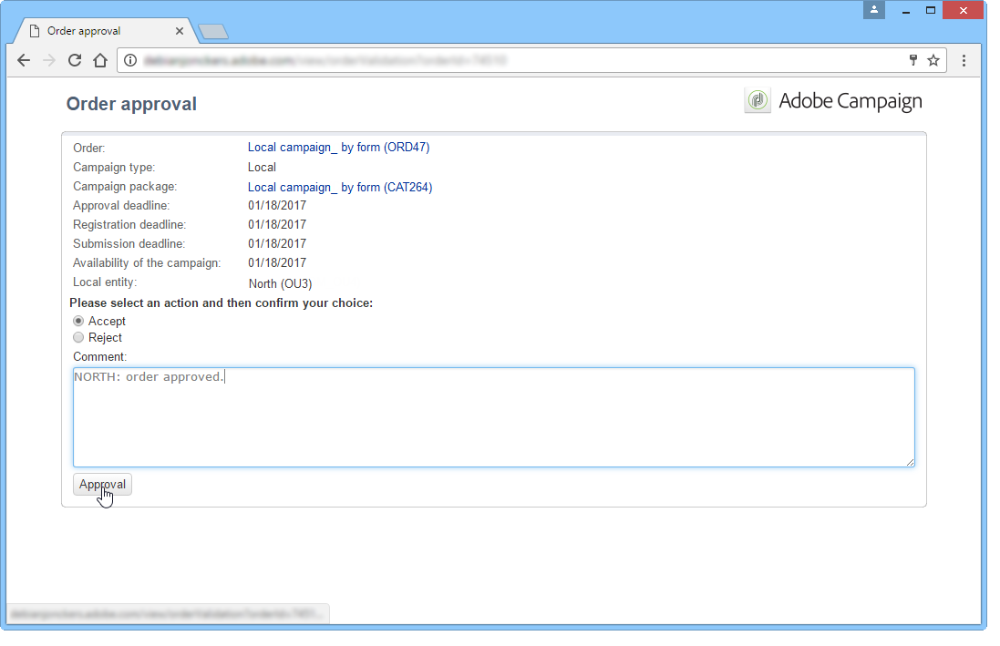

#### 通过客户端控制台批准 {#approving-via-the-adobe-campaign-console}

也可以通过客户控制台在促销活动订单概述中批准该订单。 要批准订单，请选择该订单并单击&#x200B;**[!UICONTROL Approve the order]**。

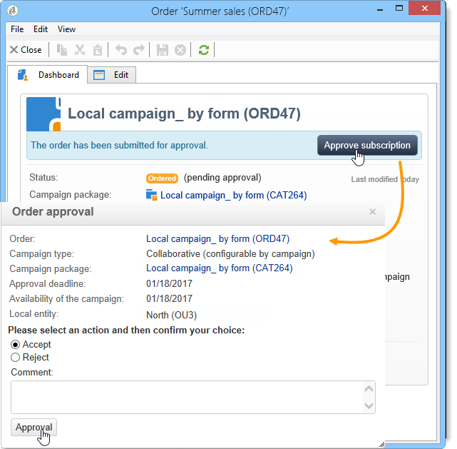

>[!NOTE]
>
>在营销活动可用日期之前，仍可以编辑和重新配置营销活动。 本地实体也可以通过单击&#x200B;**[!UICONTROL Cancel]**&#x200B;按钮拒绝营销活动。

#### 创建活动 {#creating-a-campaign}

营销活动订单获得批准后，可以由本地实体配置并执行。

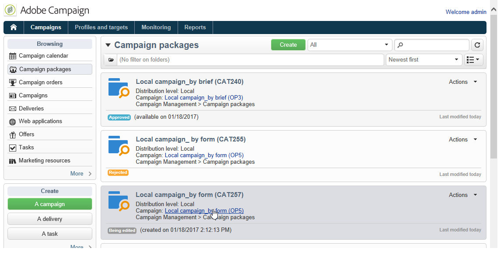

有关详情，请参阅[访问营销活动](accessing-campaigns.md)。

### 拒绝审批 {#rejecting-an-approval}

负责审批的操作员可以拒绝订单或活动程序包。

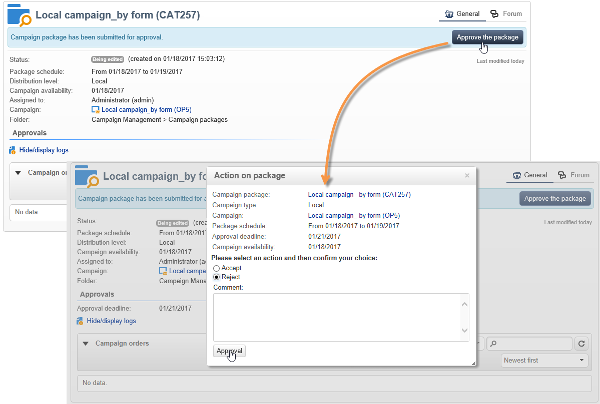

如果复查人拒绝订单，则系统会自动将相关通知发送给相关的本地实体：显示拒绝审批的操作员输入的备注。

信息显示在活动包列表页面或活动订单页面上。 如果他们有权访问Adobe Campaign Client Console，则会将此拒绝通知本地实体。

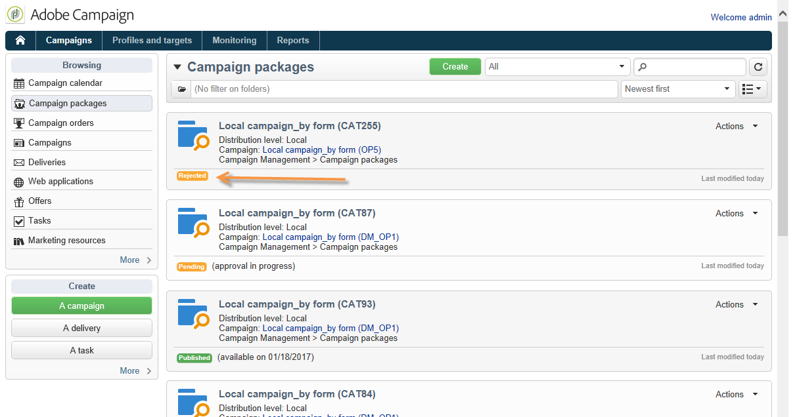

他们可以在营销活动包的&#x200B;**[!UICONTROL Edit]**&#x200B;选项卡中查看相关评论。

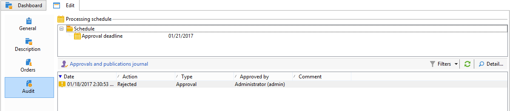

### 审阅者 {#reviewers}

每次需要审批时，审阅人都会收到电子邮件通知。

对于每个本地实体，将选择审阅人进行营销活动订单批准和营销活动批准。 有关选择本地审阅者的详细信息，请参阅[组织实体](about-distributed-marketing.md#organizational-entities)。

>[!NOTE]
>
>要使此选择成为可能，订单审批必须尚未生效。

### 取消订单 {#canceling-an-order}

中央机构可以使用订单仪表板上的&#x200B;**[!UICONTROL Delete]**&#x200B;按钮取消订单。

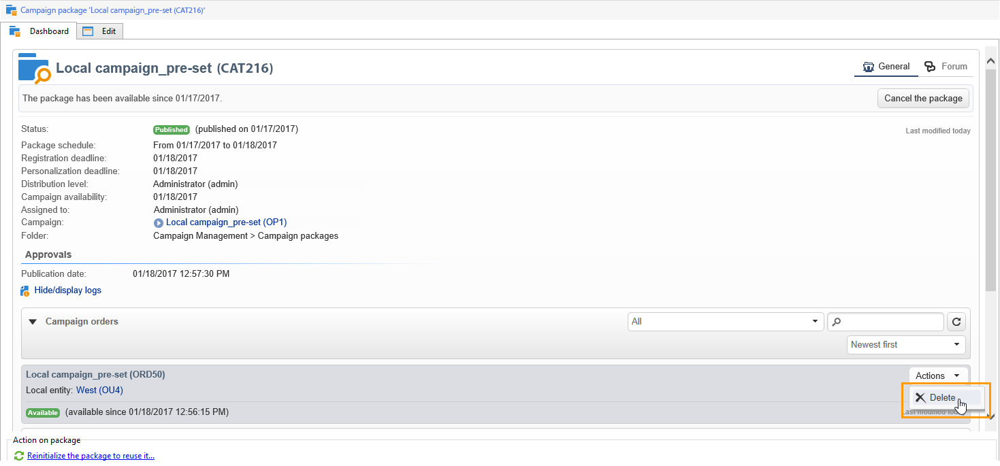

这将取消&#x200B;**[!UICONTROL Campaign orders]**&#x200B;视图中的营销活动。
