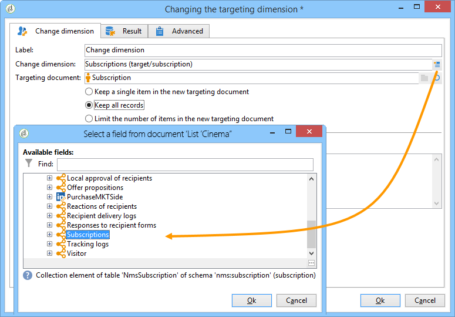
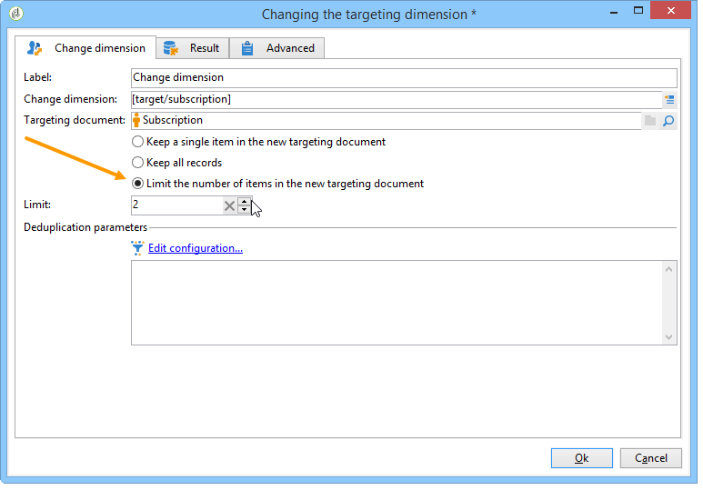
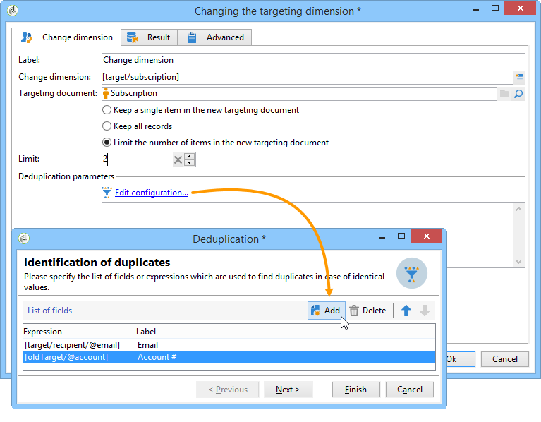
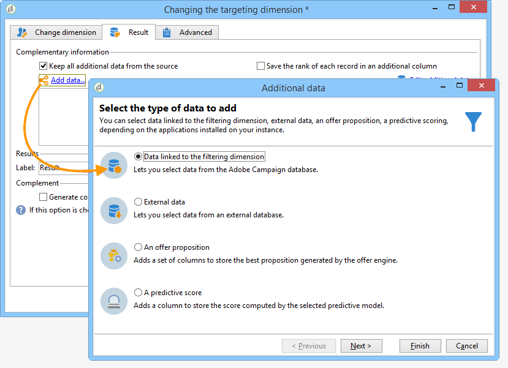
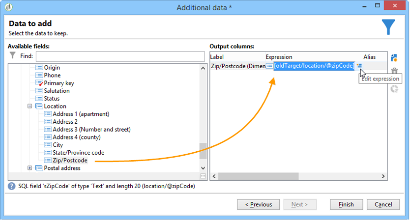
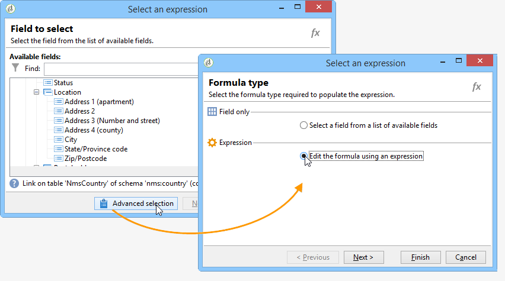
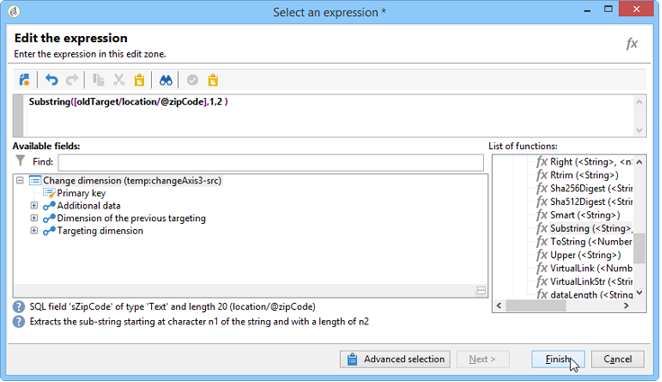
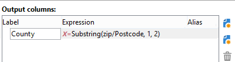
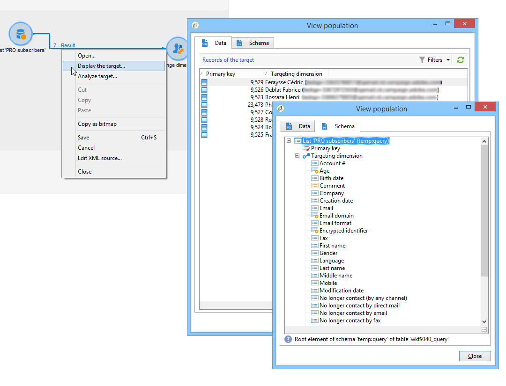
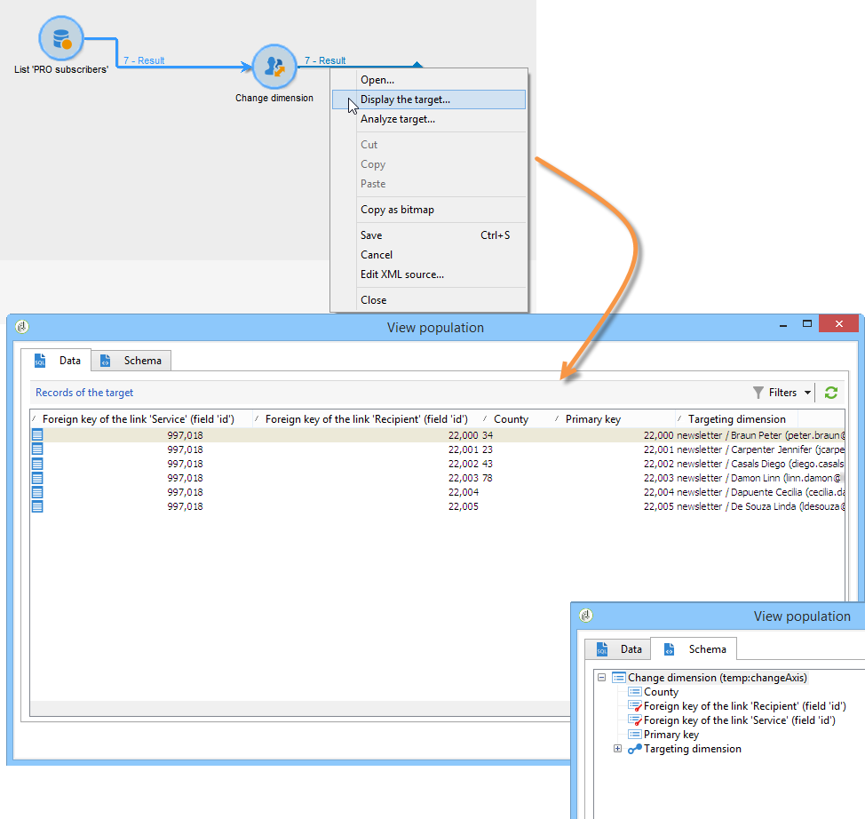

# 更改维度{#change-dimension}

在您构建受众时，可使用&#x200B;**[!UICONTROL Change dimension]**&#x200B;活动更改定向维度。 此活动根据数据模板和输入维度移动轴。 例如，从“合同”维度切换到“客户”维度。

您还可以使用此活动定义新目标的附加列，并定义重复数据删除标准。

>[!IMPORTANT]
>
>请注意，不应将&#x200B;**[!UICONTROL Change Dimension]**&#x200B;和&#x200B;**[!UICONTROL Change Data source]**&#x200B;活动添加到一行中。 如果需要连续使用这两个活动，请确保在它们之间包含&#x200B;**[!UICONTROL Enrichement]**&#x200B;活动。 这可以确保正确执行并防止潜在的冲突或错误。

要配置&#x200B;**[!UICONTROL Change dimension]**&#x200B;活动，请应用以下步骤：

1. 通过&#x200B;**[!UICONTROL Change dimension]**&#x200B;字段Select新的定向维度。

   

1. 在尺寸更改过程中，可保留所有元素或选取要保留在输出中的元素。 在以下示例中，最大 重复项数设置为2。

   的情况下限制新定位文档中的项目数

   当您选择只保留一个记录时，会在工作架构中显示一个集合：此集合表示在最终结果中不会定向的所有记录（因为只保留一个记录）。 与所有其他收藏集一样，这个收藏集允许您计算聚合或恢复列中的信息。

   例如，如果您将&#x200B;**[!UICONTROL Customers]**&#x200B;维度更改为&#x200B;**[!UICONTROL Recipients]**&#x200B;维度，则可以定位特定商店的客户，同时添加购买的次数。

1. 如果选择不保留所有这些信息，则可以配置复制管理模式。

   

   蓝色箭头允许您定义重复的处理优先级。

   在上面的示例中，将先在收件人的电子邮件地址上删除重复项，然后根据需要在其帐号上删除重复项。

1. **[!UICONTROL Result]**&#x200B;选项卡允许您添加其他信息。

   例如，您可以使用&#x200B;**Substring**&#x200B;类型函数，根据邮政编码恢复县。 操作步骤：

   * 单击&#x200B;**[!UICONTROL Add data...]**&#x200B;链接并选择&#x200B;**[!UICONTROL Data linked to the filtering dimension]**。

     

     >[!NOTE]
     >
     >有关创建和管理其他列的信息，请参阅[添加数据](query.md#adding-data)。

   * Select上一个定向维度（在轴切换之前），并在收件人的&#x200B;**[!UICONTROL Location]**&#x200B;子树中选择&#x200B;**[!UICONTROL Zip Code]**，然后单击&#x200B;**[!UICONTROL Edit expression]**。

     

   * 单击&#x200B;**[!UICONTROL Advanced selection]**&#x200B;并选择&#x200B;**[!UICONTROL Edit the formula using an expression]**。

     

   * 使用列表中提供的函数并指定要执行的计算。

     

   * 最后，输入刚刚创建的列的标签。

     

1. 执行工作流可查看此配置的结果。 比较变更维活动之前和之后的表中的数据，并比较工作流表的结构，如以下示例所示：

   

   
