# 创建摘要列表{#creating-a-summary-list}

此使用案例详细说明了如何创建工作流，在收集文件并完成几项增强后，可让您创建摘要列表。 此示例基于在商店中进行购买的联系人列表。

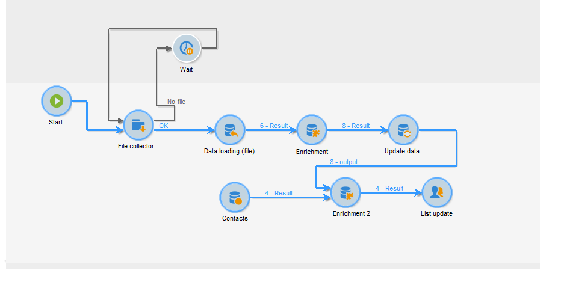

使用以下数据结构：

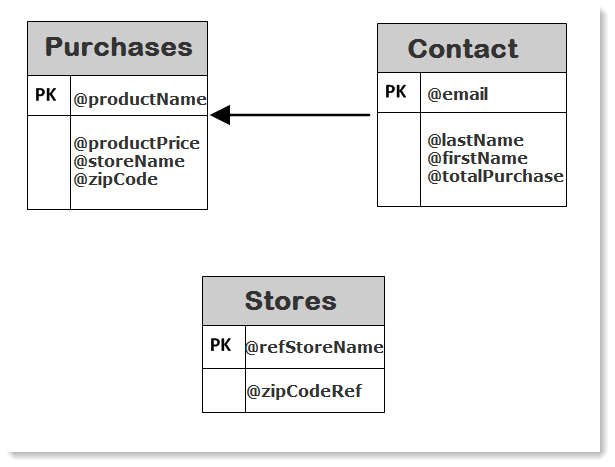

其目的是：

* 使用扩充活动的各种选项
* 要在协调后更新数据库中的数据，请执行以下操作
* 创建扩充数据的全局“视图”

要创建摘要列表，您需要执行以下步骤：

1. 在工作流的工作表中收集和加载“购买”文件
1. 通过创建指向引用表的链接来扩充导入的数据
1. 使用扩充数据更新“购买”表
1. 使用“购买”表中的聚合计算扩充“联系人”数据
1. 创建摘要列表

## 步骤1：加载文件并协调导入的数据 {#step-1--loading-the-file-and-reconciling-the-imported-data}

要加载的数据是采用以下格式的“购买”相关数据：

```
Product Name;Product price;Store
Computer;2000;London 3
Tablet;600;Cambridge
Computer;2000;London 5
Computer;2000;London 8
Tablet;600;Cambridge
Phone;500;London 5
```

此数据包含在“Purchases.txt”文本文件中。

1. 将&#x200B;**文件收集器**&#x200B;和&#x200B;**数据加载（文件）**&#x200B;活动添加到工作流。

   **文件收集器**&#x200B;活动允许您从Adobe Campaign服务器收集文件并将文件发送到该服务器。

   **数据加载（文件）**&#x200B;活动允许您使用收集的数据扩充工作流的工作表。 有关此活动的详细信息，请参阅[数据加载（文件）](data-loading-file.md)。

1. 配置&#x200B;**文件收集器**&#x200B;活动以从所选目录中收集文本(&#42;.txt)类型文件。

   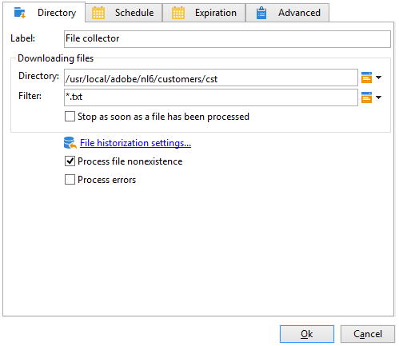

   通过&#x200B;**文件收集器**&#x200B;活动，您可以管理源目录中不存在文件。 为此，请选中&#x200B;**[!UICONTROL Process file nonexistence]**&#x200B;选项。 在此工作流中，已添加&#x200B;**Wait**&#x200B;活动以尝试其他文件集合（如果在集合时目录中缺少该集合）。

1. 使用与要导入的数据格式相同的示例文件配置&#x200B;**数据加载（文件）**&#x200B;活动。

   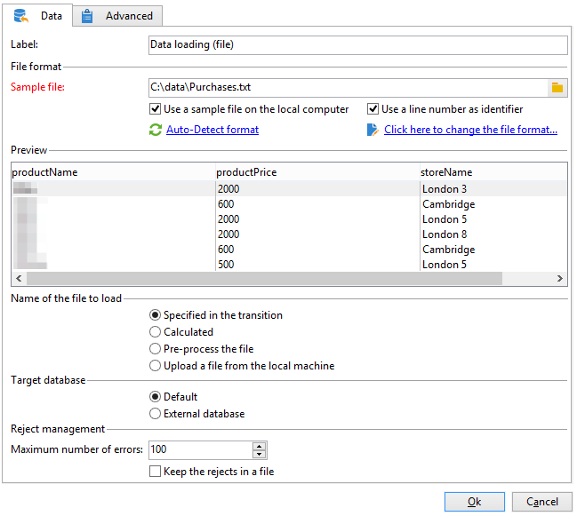

   单击&#x200B;**[!UICONTROL Click here to change the file format...]**&#x200B;链接可使用“购买”表的内部名称和标签重命名列。

   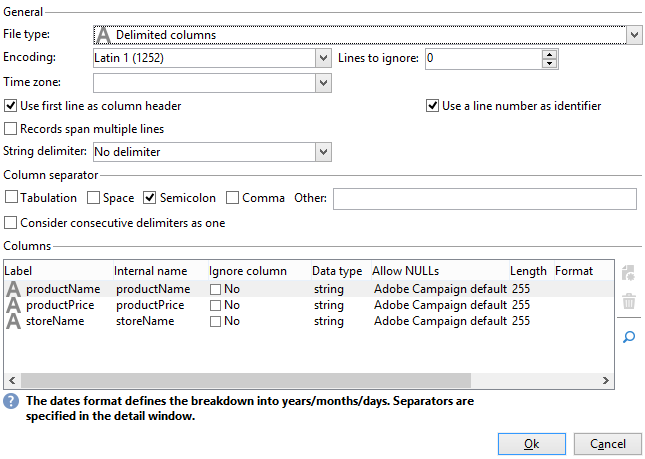

导入数据后，可通过创建指向与“存储”模式匹配的参考表的链接来执行扩充。

添加扩充活动并按如下方式对其进行配置：

1. Select主集由&#x200B;**数据加载（文件）**&#x200B;活动中的数据组成。

   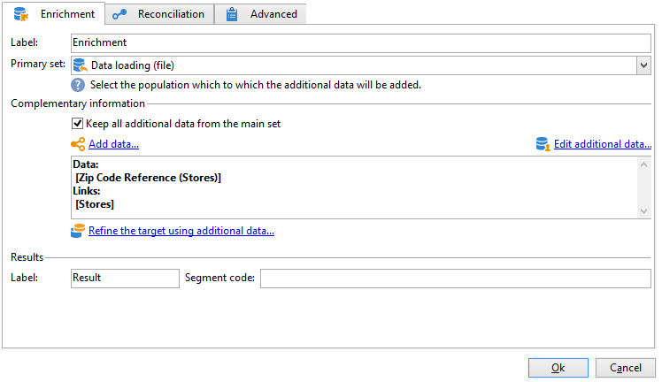

1. 单击&#x200B;**[!UICONTROL Add data]**，然后选择&#x200B;**[!UICONTROL A link]**&#x200B;选项。

   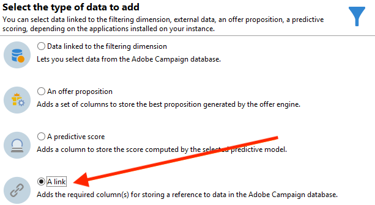

1. 选择 **[!UICONTROL Define a collection]** 选项。
1. 将“存储”模式作为目标Select。

   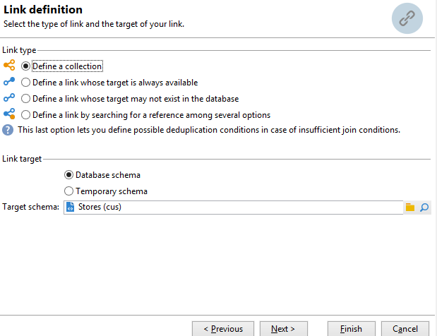

有关各种链接类型的详细信息，请参阅[扩充和修改数据](targeting-workflows.md#enrich-and-modify-data)。

在以下窗口中，您需要通过选择源字段（在主集中）和目标字段（属于“存储”模式）来创建连接条件，以配置数据协调。

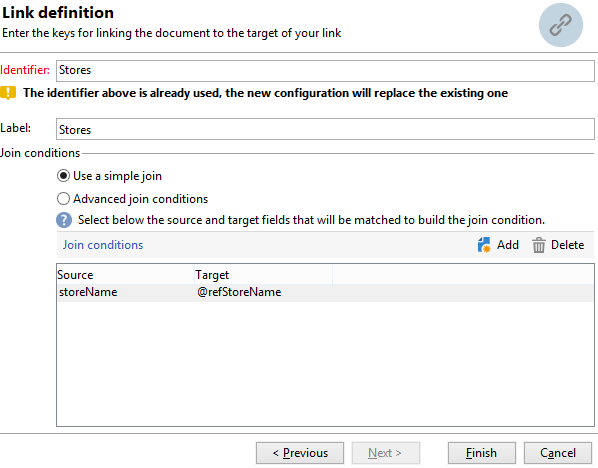

现在，链接已创建，我们将从“商店”架构向工作流的工作表添加一列：“邮政编码引用”字段。

1. 打开扩充活动。
1. 单击 **[!UICONTROL Edit additional data]**。
1. 将“ZipCode引用”字段添加到&#x200B;**[!UICONTROL Output columns]**。

已将Stores链接中的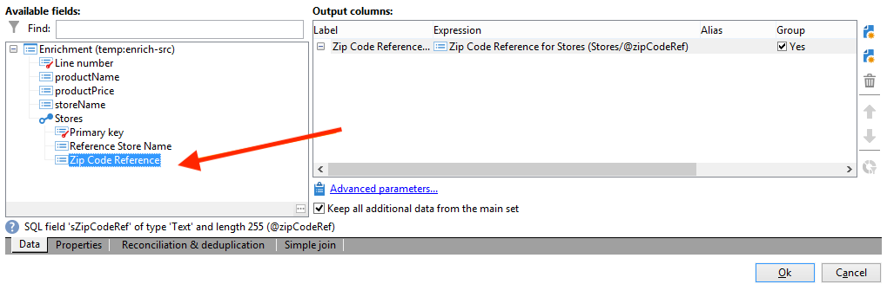

在此扩充之后，工作流工作表中的数据将如下所示：

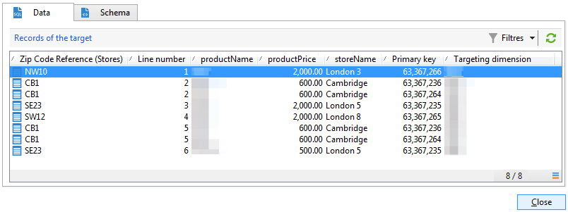

## 步骤2：将扩充数据写入“购买”表 {#step-2--writing-enriched-data-to-the--purchases--table}

此步骤详细说明了如何将导入和扩充数据写入“购买”表。 为此，我们需要使用&#x200B;**更新数据**&#x200B;活动。

在更新&#x200B;**Purchases**&#x200B;表中的数据之前，必须执行工作流工作表中的数据与&#x200B;**Purchases**&#x200B;目标维度之间的协调。

1. 单击扩充活动的&#x200B;**[!UICONTROL Reconciliation]**&#x200B;选项卡。
1. Select定位维度，在此例中为“购买”架构。
1. Select是工作流表（本例中为“storeName”字段）中数据的“Source表达式”。
1. Select是“购买”表（本例中为“storename”字段）中数据的“目标表达式”。
1. 勾选 **[!UICONTROL Keep unreconciled data coming from the work table]** 选项。

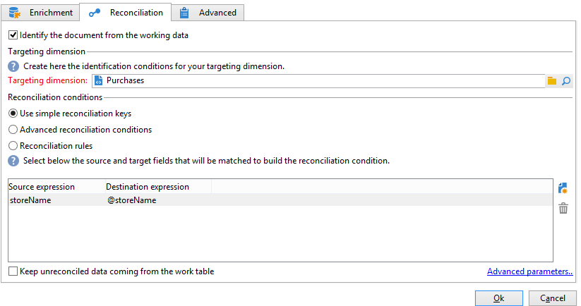

在&#x200B;**更新数据**&#x200B;活动中，需要以下配置：

1. 在&#x200B;**[!UICONTROL Operation type]**&#x200B;字段中Select **[!UICONTROL Insert or update]**&#x200B;选项，以避免每次收集文件时都创建新记录。
1. Select **[!UICONTROL Record identification]**&#x200B;选项的&#x200B;**[!UICONTROL By directly using the targeting dimension]**&#x200B;值。
1. 将“购买”架构作为&#x200B;**[!UICONTROL Document type]** Select。
1. 指定要更新的字段列表。 **[!UICONTROL Destination]**&#x200B;列允许您定义“购买”架构的字段。 **[!UICONTROL Expression]**&#x200B;列允许您选择工作表中的字段以执行映射。
1. 单击&#x200B;**[!UICONTROL Generate an outbound transition]**&#x200B;选项。


## 步骤3：扩充“联系人”数据 {#step-3--enriching--contact--data-}

“联系人”模式会物理链接到“购买”模式。 这意味着您可以使用“扩充”选项的另一个选项：添加链接到筛选维度的数据。

此第二次扩充的目的是创建采购架构的聚合，以计算每个已识别联系人的采购总额。

1. 添加&#x200B;**查询**&#x200B;类型活动，以便恢复存储的所有&#x200B;**联系人**。
1. 添加&#x200B;**扩充**&#x200B;活动，然后选择从上一个查询生成的主集。
1. 单击添加&#x200B;**[!UICONTROL Data]**。
1. 单击&#x200B;**[!UICONTROL Data linked to the targeting dimension]**&#x200B;选项。
1. 在&#x200B;**[!UICONTROL Select fields to add]**&#x200B;窗口中单击&#x200B;**[!UICONTROL Data linked to the filtering dimension]**&#x200B;选项。
1. Select **[!UICONTROL Purchases]**&#x200B;节点，然后单击&#x200B;**[!UICONTROL Next]**。

   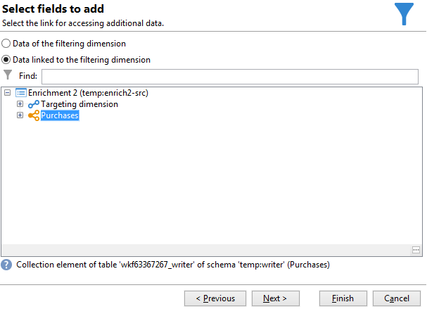

1. 通过选择&#x200B;**[!UICONTROL Aggregates]**&#x200B;选项更改&#x200B;**[!UICONTROL Collected data]**&#x200B;字段。

   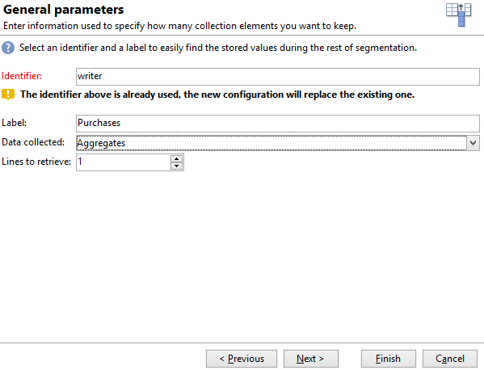

1. 单击 **[!UICONTROL Next]**。
1. 添加以下表达式以计算每个联系人的购买总计：“Sum(@prodprice)”。

   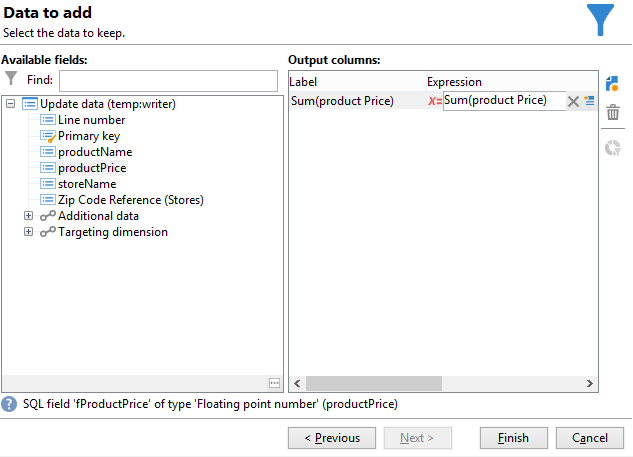

要准备摘要列表，您需要从“购买”字段和第一个扩充字段（“邮政编码引用”字段）中添加字段。

1. 单击扩充活动中的&#x200B;**[!UICONTROL Edit additional data...]**&#x200B;链接。
1. 添加“商店名称”和“购买/邮政编码引用”字段。

   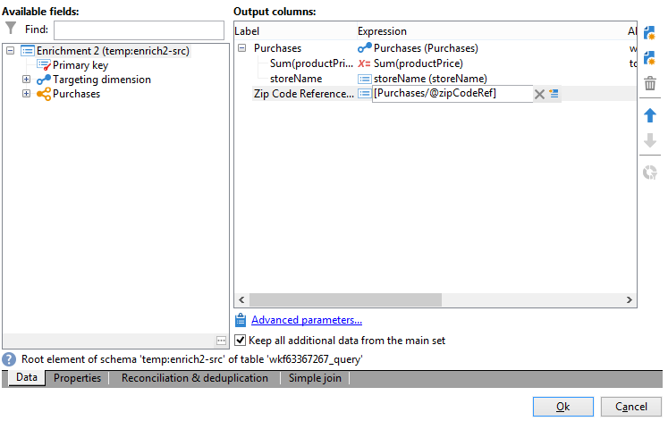

1. 单击&#x200B;**[!UICONTROL Properties]**&#x200B;选项卡。
1. 更改第二个链接以仅创建一行。

## 第4步：创建并添加到摘要列表 {#step-4--creating-and-adding-to-a-summary-list}

最后一步是将所有扩充数据写入列表。

1. 将&#x200B;**列表更新**&#x200B;活动添加到工作流。 此活动必须链接到第二个扩充活动的叫客过渡。
1. 选择 **[!UICONTROL Create the list if necessary (Calculated name)]** 选项。
1. Select计算名称的值。 为列表选择的标签为当前日期： &lt;%= formatDate(new Date()，“%2D/%2M/%2Y”) %>。

执行工作流后，列表将包括：

* 联系人列表，
* “总购买量”列，
* “商店名称”列，
* 为商店引用架构中包含的所有商店输入的“邮政编码引用”列。

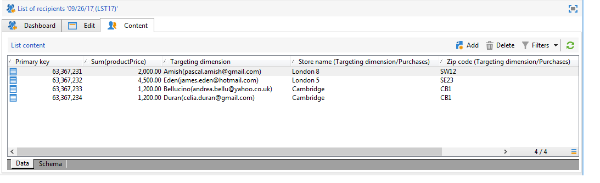
