# 具有自定义日期字段的电子邮件扩充{#email-enrichment-with-custom-date-fields}


在本例中，我们希望向本月即将过生日的收件人发送一封包含自定义数据字段的电子邮件。 电子邮件将包含优惠券，有效期限为他们生日前后一周。

我们需要通过&#x200B;**[!UICONTROL Split]**&#x200B;活动定位本月将庆祝其生日的列表中的收件人。 然后，使用&#x200B;**[!UICONTROL Enrichment]**&#x200B;活动，自定义数据字段将用作客户特殊优惠的电子邮件中的有效日期。

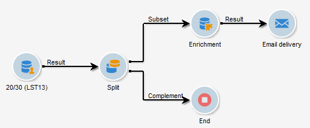

要创建此示例，请应用以下步骤：

1. 在营销活动的&#x200B;**[!UICONTROL Targeting and workflows]**&#x200B;选项卡中，拖放&#x200B;**[!UICONTROL Read list]**&#x200B;活动以定向收件人列表。
1. 要处理的列表可以显式指定、由脚本计算或根据此处定义的选项和参数进行动态本地化。

   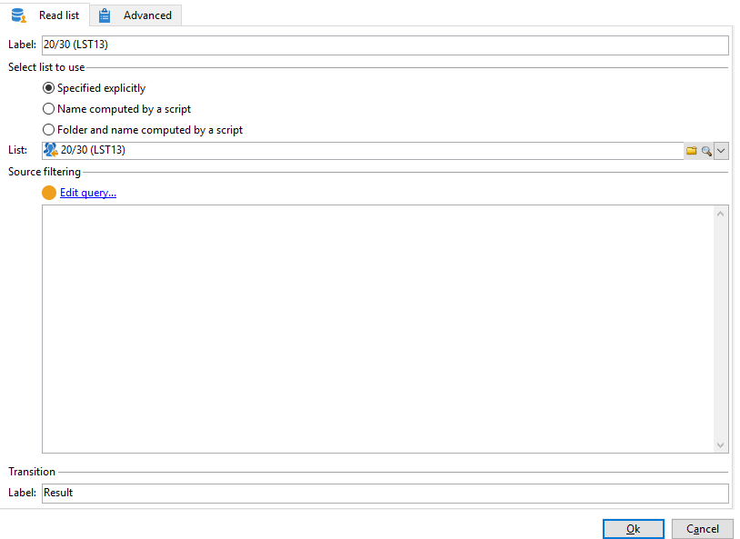

1. 添加&#x200B;**[!UICONTROL Split]**&#x200B;活动以将本月即将过生日的收件人与其他收件人区分开来。
1. 要拆分列表，请在&#x200B;**[!UICONTROL Filtering of selected records]**&#x200B;类别中选择&#x200B;**[!UICONTROL Add a filtering condition on the inbound population]**。 然后，单击&#x200B;**[!UICONTROL Edit]**。

   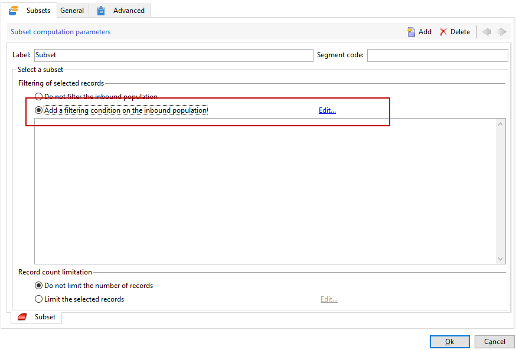

1. 然后，Select **[!UICONTROL Filtering conditions]**&#x200B;单击“**[!UICONTROL Edit expression]**”按钮以筛选收件人生日的月份。

   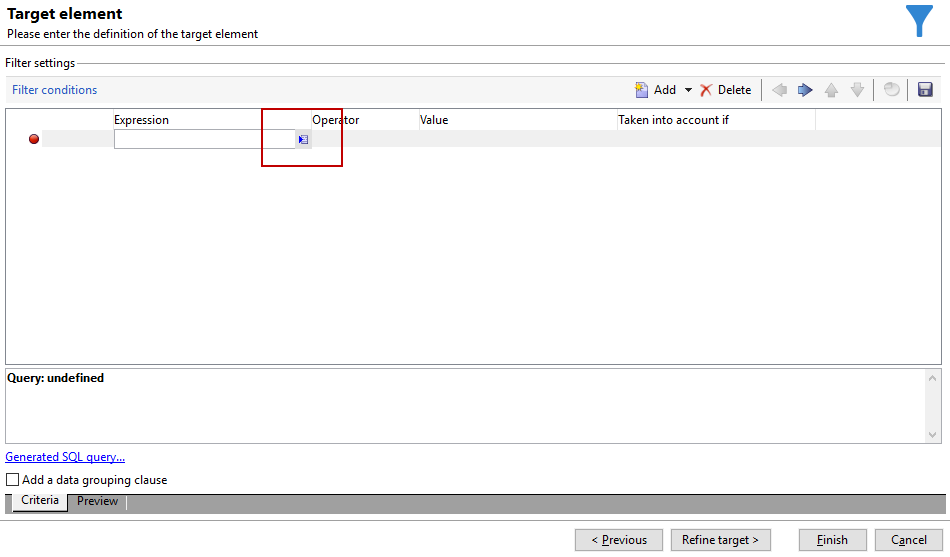

1. 单击&#x200B;**[!UICONTROL Advanced Selection]**，然后单击&#x200B;**[!UICONTROL Edit the formula using an expression]**&#x200B;并添加以下表达式： Month(@birthDate)。
1. 在&#x200B;**[!UICONTROL Operator]**&#x200B;列中选择&#x200B;**[!UICONTROL equal to]**。
1. 通过添加当前日期的&#x200B;**[!UICONTROL Value]**&#x200B;个月进一步筛选条件： Month(GetDate())。

   这将查询其生日月份对应于当月的收件人。

   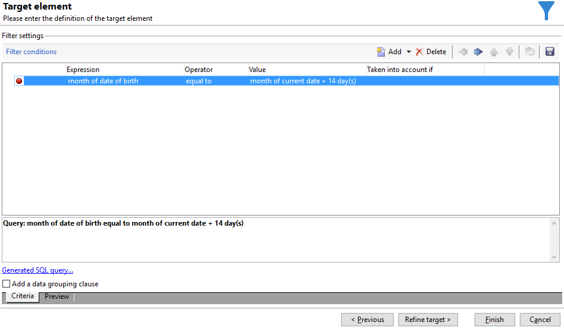

1. 单击 **[!UICONTROL Finish]**。 然后，在&#x200B;**[!UICONTROL Split]**&#x200B;活动的&#x200B;**[!UICONTROL General]**&#x200B;选项卡中，单击&#x200B;**[!UICONTROL Results]**&#x200B;类别中的&#x200B;**[!UICONTROL Generate complement]**。

   利用&#x200B;**[!UICONTROL Complement]**&#x200B;结果，您可以添加投放活动或更新列表。 此处，我们刚刚添加了一个&#x200B;**[!UICONTROL End]**&#x200B;活动。

   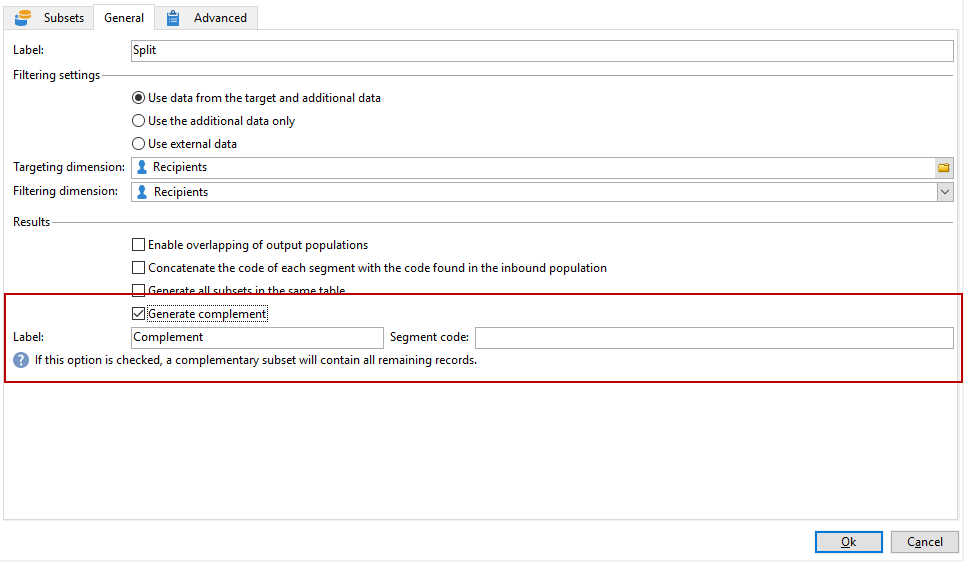

您现在需要配置&#x200B;**[!UICONTROL Enrichment]**&#x200B;活动：

1. 在子集后添加&#x200B;**[!UICONTROL Enrichment]**&#x200B;活动以添加自定义日期字段。

   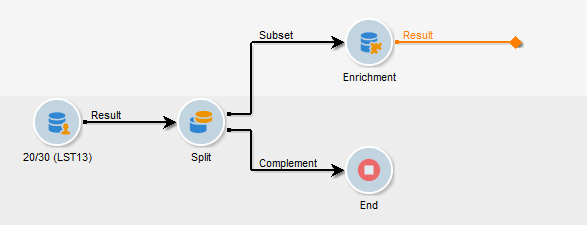

1. 打开您的&#x200B;**[!UICONTROL Enrichment]**&#x200B;活动。 在&#x200B;**[!UICONTROL Complementary information]**&#x200B;类别中，单击&#x200B;**[!UICONTROL Add data]**。

   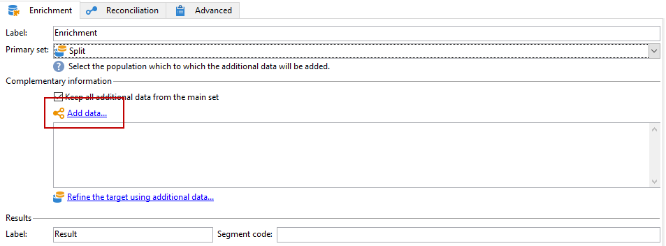

1. Select **[!UICONTROL Data linked to the filtering dimension]**，然后&#x200B;**[!UICONTROL Data of the filtering dimension]**。
1. 单击 **[!UICONTROL Add]** 按钮。

   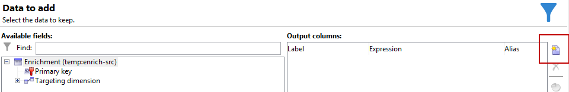

1. 添加&#x200B;**[!UICONTROL Label]**。 然后，在&#x200B;**[!UICONTROL Expression]**&#x200B;列中单击&#x200B;**[!UICONTROL Edit expression]**。

   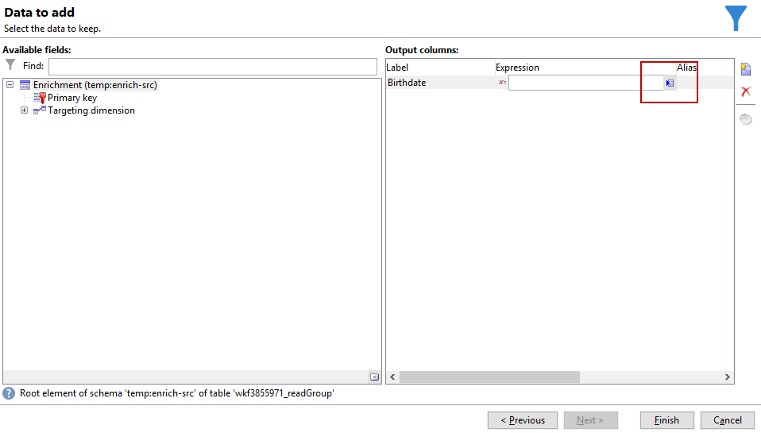

1. 首先，我们需要将出生日期之前的一周作为&#x200B;**有效开始日期**，并设置以下&#x200B;**[!UICONTROL Expression]**： `SubDays([target/@birthDate], 7)`。

   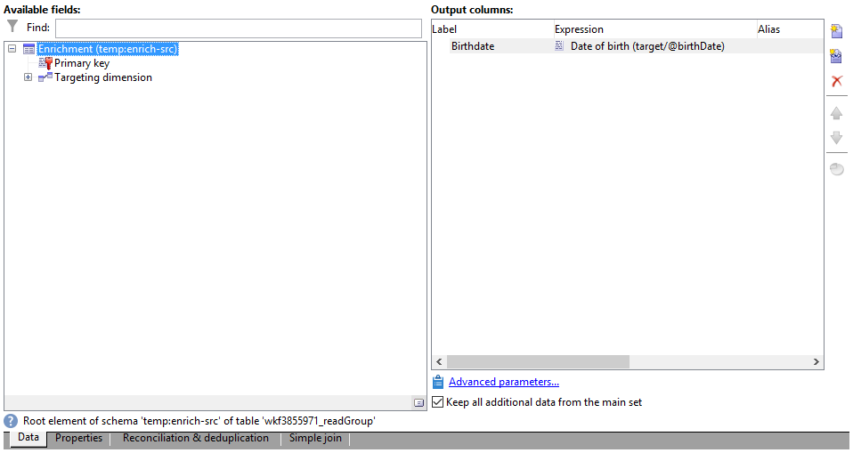

1. 然后，要创建以出生日期后的一周为目标的自定义日期字段&#x200B;**有效期结束日期**，您需要添加&#x200B;**[!UICONTROL Expression]**： `AddDays([target/@birthDate], 7)`。

   您可以在表达式中添加标签。

   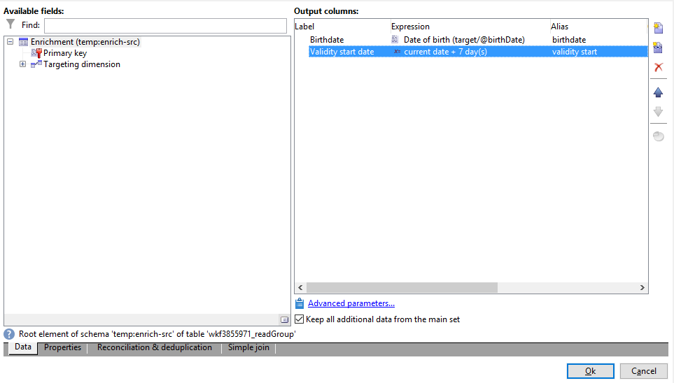

1. 单击 **[!UICONTROL Ok]**。 您的扩充现已准备就绪。

在您的&#x200B;**[!UICONTROL Enrichment]**&#x200B;活动后，您可以添加投放。 在本例中，我们添加了电子邮件投放，以向收件人发送包含有效日期的特殊优惠，供本月庆祝其生日的客户使用。

1. 将&#x200B;**[!UICONTROL Email delivery]**&#x200B;活动拖放到您的&#x200B;**[!UICONTROL Enrichment]**&#x200B;活动之后。

   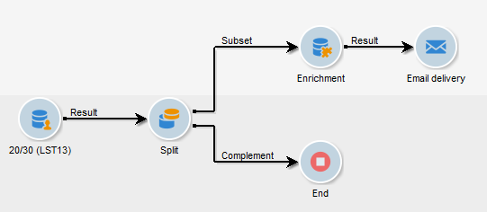

1. 双击您的&#x200B;**[!UICONTROL Email delivery]**&#x200B;活动以开始个性化您的投放。
1. 向投放添加&#x200B;**[!UICONTROL Label]**&#x200B;并单击&#x200B;**[!UICONTROL Continue]**。
1. 单击&#x200B;**[!UICONTROL Save]**&#x200B;以创建您的电子邮件投放。
1. 在电子邮件投放&#x200B;**[!UICONTROL Properties]**&#x200B;的&#x200B;**[!UICONTROL Approval]**&#x200B;选项卡中签入&#x200B;**[!UICONTROL Confirm delivery before sending option]**&#x200B;是否已选中。

   然后，启动工作流以使用定向信息扩充叫客过渡。

   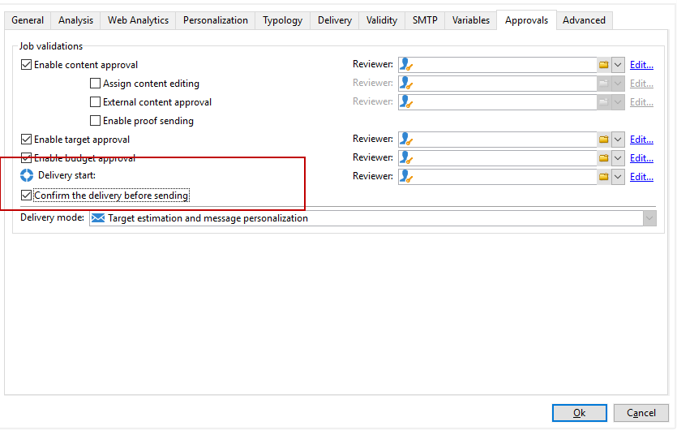

您现在可以使用在&#x200B;**[!UICONTROL Enrichment]**&#x200B;活动中创建的自定义日期字段开始设计电子邮件投放。

1. 双击您的&#x200B;**[!UICONTROL Email delivery]**&#x200B;活动。
1. 将您的Target扩展添加到电子邮件中。 它应位于以下表达式内，以便配置有效日期的格式：

   ```
   <%=
           formatDate(targetData.alias of your expression,"%2D.%2M")  %>
   ```

1. 单击带有下拉箭头的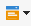。Select **[!UICONTROL Target extension]**&#x200B;将先前创建的自定义有效期与&#x200B;**[!UICONTROL Enrichment]**&#x200B;活动一起使用，以将您的扩展添加到formatDate表达式中。

   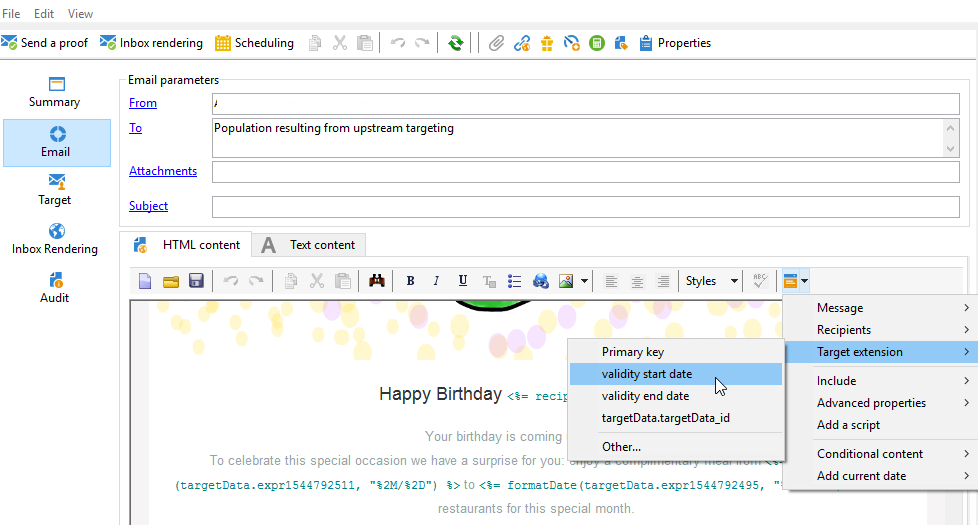

1. 根据需要配置电子邮件内容。

   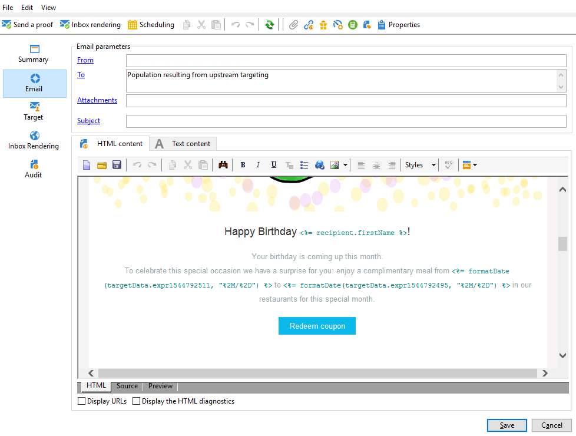的HTML内容的电子邮件。

1. 预览电子邮件以检查自定义日期字段是否已正确配置

   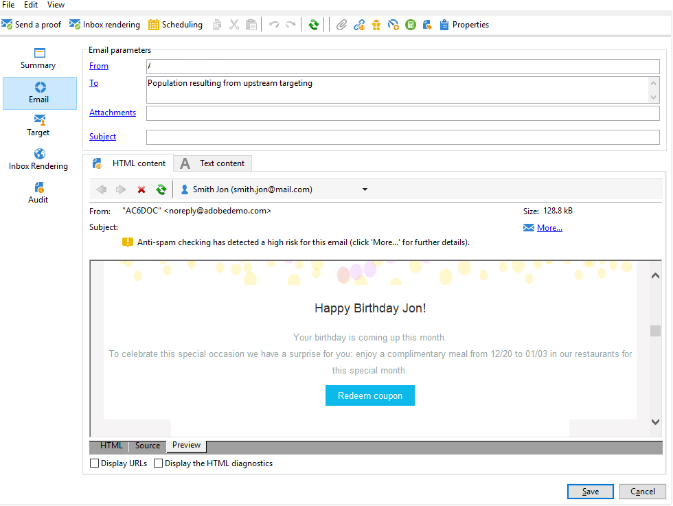

您的电子邮件现已准备就绪。 您可以开始发送校样并确认您的投放以发送生日电子邮件。
