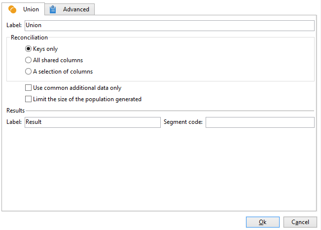
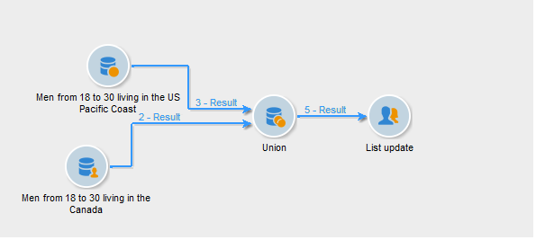

# 并集{#union}

**[!UICONTROL Union]**&#x200B;将多个集客活动的结果分组到一个目标中。 创建目标时收到所有结果：因此，必须完成所有先前的活动才能执行合并。

>[!NOTE]
>
>有关配置和使用&#x200B;**[!UICONTROL Union]**&#x200B;活动的详细信息，请参阅[合并多个目标（联合）](targeting-workflows.md#combine-several-targets--union-)。

## 合并示例 {#union-example}

在以下示例中，两个查询的结果已合并，以更新列表。 这两个查询以收件人为目标。 因此，结果基于同一表。

1. 在两个查询之后并在列表的更新类型活动之前直接插入&#x200B;**[!UICONTROL Union]** — 类型活动，然后打开它。
1. 您可以输入标签。
1. Select **[!UICONTROL Keys only]**&#x200B;协调方法，因为在此示例中，由查询生成的填充包含一致数据。
1. 如果您为查询添加了其他数据，则可以决定只保留共享的数据。
1. 如果要限制最终群体的大小，请选中&#x200B;**[!UICONTROL Limit size of generated population]**&#x200B;选项。

   通过输入最大收件人数量并选择其群体优先的查询来指定此最终数量。

1. 批准&#x200B;**[!UICONTROL Union]**&#x200B;活动，然后配置[列表更新](list-update.md)活动。
1. 启动工作流。 将显示结果数量，并创建或更新在列表更新活动中定义的列表。 此列表包含两个查询的收件人集，或者，如果适用，包含上一步中定义的编号。

   

## 输入参数 {#input-parameters}

* 表名
* 架构

每个入站事件必须指定由这些参数定义的目标。

## 输出参数 {#output-parameters}

* 表名
* 架构
* recCount

这组三个值标识合并产生的目标。 **[!UICONTROL tableName]**&#x200B;是记录目标标识符的表的名称，**[!UICONTROL schema]**&#x200B;是群体的架构（通常为nms:recipient），**[!UICONTROL recCount]**&#x200B;是表中的元素数。
