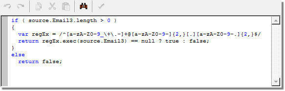

# 代码编辑

用于编辑源代码的控制。



## 属性

**backColor — 字符串**&#x200B;背景颜色（btnshadow，白色）。

**边框 — 字符串**&#x200B;更改控件轮廓样式（实线、双线、内缩、外凸、无）。

**contentType - string**&#x200B;源代码的语言，用于语法着色和其他链接到语言的选项。 支持以下语言：

* 默认
* xml
* dtd
* xsl
* html
* txt
* JavaScript
* sql

通过编辑与nlclient.exe位于同一目录中的editor.cfg文件，还可以添加其他语言。

**font-size - integer**&#x200B;更改字体大小。

**标签 — 字符串**&#x200B;关联的标签。

**nolabel — 布尔值**&#x200B;隐藏关联的标签。

**readOnly — 布尔值**&#x200B;强制控件为只读。

**toobar — 布尔值**&#x200B;显示或隐藏工具栏。

**toolbarAlign — 字符串**&#x200B;工具栏的位置：水平或垂直。

## 备注

示例：

```xml
<input xpath="code" nolabel="true" type="CodeEdit"
       contentType="JavaScript" toolbar="true" toolbarAlign="horizontal"/>
```
